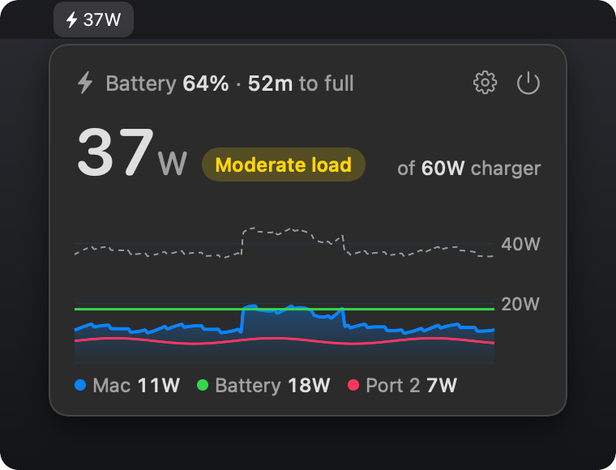
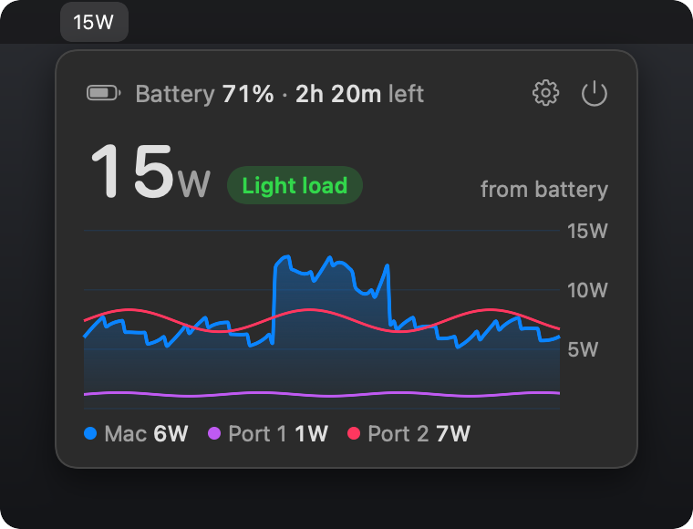

# wattusb

[](https://github.com/benlumley/wattusb/releases/latest)
[](https://github.com/benlumley/wattusb/releases)
[](#install)
[](LICENSE)

Tiny macOS menu bar app that shows the live wattage your Mac is drawing, from its USB-C / MagSafe charger when plugged in, or from the battery when not. Click it for a live chart of where the power's going.

**[benlumley.github.io/wattusb](https://benlumley.github.io/wattusb/)**

<p align="center">
  
  &nbsp;
  
</p>

## Features

- ⚡ **Live watts in the menu bar**, from the charger or the battery.
- 📈 **A live chart** of the last 5 minutes. Hover to scrub back.
- 🔌 **Where the power goes**: the Mac, the battery, and each device on its ports.
- 🔋 **Charger and battery details**: volts, amps, time left and health.
- 🪶 **Featherweight and private**: no dock icon, no network, no telemetry.

Useful for:

- Telling whether a given charger is actually delivering its rated power.
- Comparing ports on multi-port chargers (the "fast" port vs the slower ones).
- Sanity-checking cables: a flaky cable will cap the negotiated voltage and the wattage drops accordingly.
- Seeing how much power your Mac, and anything plugged into it, is using on battery.

## What it shows

**Menu bar**: the total, e.g. `⚡ 37W`.

- **Plugged in**: watts coming in from the charger, with a bolt while charging and a plug once it's full or on hold.
- **On battery**: watts coming out of the battery, i.e. what your Mac and its devices are using right now.

**Click for the panel**:

- **Battery**: level, and time to full or time left. Hover for health, cycles and temperature.
- **The big number**: the same total, with the load and either "of 60W charger" or "from battery". Hover for the full breakdown: input volts and amps, the charger's PD contract, and each split.
- **Chart**: the Mac, the battery and each device over the last 5 minutes, with the charger's input dashed. Hover to scrub back through it.
- **Gear**: Open at Login, Keyboard Shortcuts and About.

## Install

### Homebrew (recommended)

```sh
brew install --cask benlumley/tap/wattusb
```

The app is ad-hoc signed (not notarized), so on **first launch** macOS Gatekeeper
will block it. Approve it once: on macOS 15 (Sequoia) or later, try to open it, then click
**Open Anyway** in System Settings → Privacy & Security; on macOS 14, right-click
`wattusb.app` → **Open**. Or run:

```sh
xattr -dr com.apple.quarantine /Applications/wattusb.app
```

Update or remove later with `brew upgrade --cask benlumley/tap/wattusb` /
`brew uninstall --cask wattusb`.

### Build from source

```sh
git clone https://github.com/benlumley/wattusb.git
cd wattusb
sh build.sh
mv wattusb.app /Applications/
open /Applications/wattusb.app
```

Requires macOS 14+ and Xcode. The build script produces a universal binary
(Apple Silicon + Intel) and ad-hoc signs it so Gatekeeper lets it launch.

## CI and releases

- **CI** (`.github/workflows/ci.yml`) runs on every pull request: ShellCheck and
  actionlint, a `-warnings-as-errors` compile, the universal `build.sh` build, and
  `scripts/verify-app.sh` (plist lint, both architectures present, valid ad-hoc
  signature, 5-second launch smoke test). The zipped app is attached to the run.
  The runner has no battery, so the smoke test only covers start-up and the
  "No battery data" path.
- **Release** (`.github/workflows/release.yml`) runs on every push to `main`
  except changes limited to `docs/`, `*.md`, `LICENSE`, or `.github/`. It reruns CI, then
  publishes a GitHub release `vX.Y.Z` with `wattusb-X.Y.Z.zip`.

Versioning is automatic and nothing is committed back:

- Each release bumps the patch of the latest `vX.Y.Z` tag (`0.1.0` → `0.1.1`).
  The bundle's `CFBundleShortVersionString` is stamped at build time and
  `CFBundleVersion` is the commit count.
- To start a new minor/major line, set `CFBundleShortVersionString` in
  `Sources/wattusb/Info.plist` higher than the latest tag (e.g. `0.2.0`); the next
  release uses it, then patches continue from there.
- Release runs are serialized. A commit that already has a release, or is already
  included in a newer one, is skipped, so re-runs never duplicate a release.
  Re-run via **Actions → Release → Run workflow** on `main` (also how to
  release a workflow-only change). A draft release for the next version makes
  the run fail rather than skip; publish or delete it.
- The Homebrew cask in `benlumley/homebrew-tap` is not updated automatically;
  bump its `version` and `sha256` (printed in the release notes) by hand.

## How it works

All data comes from IOKit's `AppleSmartBattery` service:

- Live input draw: `PowerTelemetryData.SystemPowerIn` (mW from the adapter), with `SystemVoltageIn` and `SystemCurrentIn`
- What the Mac itself is using: `PowerTelemetryData.SystemLoad`
- PD contract: `AdapterDetails.Watts`, `AdapterVoltage`, `Current`
- Battery side: `Voltage` × `Amperage` (signed: positive = charging, negative = discharging)
- Devices charging off the Mac's ports: `PowerOutDetails`, per USB-C port
- Battery level, time and health: `CurrentCapacity`, `TimeRemaining`, `NominalChargeCapacity` / `DesignCapacity`, `CycleCount`, `Temperature`

No entitlements, no network, no launch agent (Open at Login uses `SMAppService.mainApp`). The panel is SwiftUI with Swift Charts, and the
panel shortcut is a Carbon hot key, so it needs no accessibility access. It's an `LSUIElement` app, so there's no dock icon.

## License

MIT
