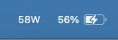
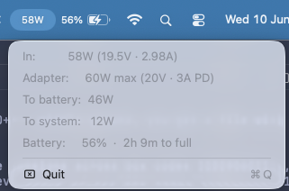
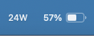
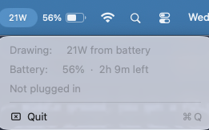

# wattusb

Tiny macOS menu bar app that shows the live wattage your Mac is currently drawing, from its USB-C / MagSafe charger when plugged in, or from the battery when not.

**[benlumley.github.io/wattusb](https://benlumley.github.io/wattusb/)**

<p align="center">
  <b>Charging</b><br>
  
  &nbsp;&nbsp;
  
</p>

<p align="center">
  <b>On battery</b><br>
  
  &nbsp;&nbsp;
  
</p>

Useful for:

- Telling whether a given charger is actually delivering its rated power.
- Comparing ports on multi-port chargers (the "fast" port vs the slower ones).
- Sanity-checking cables: a flaky cable will cap the negotiated voltage and the wattage drops accordingly.
- Seeing how much power your Mac is sipping when running on battery.

## What it shows

**Menu bar**: a single number, e.g. `58W`.

- **Plugged in**: total watts coming in from the charger.
- **On battery**: watts being drawn from the cells (i.e. what your Mac is consuming right now).

**Click for details when plugged in**:

```
In:          58W (19.5V · 2.98A)
Adapter:     60W max (20V · 3A PD)
To battery:  31W
To system:   27W
Battery:     88%  ·  1h 22m to full
─────────
✓ Open at Login
Quit
```

- **In**: real-time watts flowing in from the charger.
- **Adapter**: the PD contract the charger negotiated (its advertised max).
- **To battery** / **To system**: how the input watts split between charging the cells and running the Mac.
- **Battery**: current charge level, plus time-to-full when actively charging.

**Click for details on battery**:

```
Drawing:     12W from battery
Battery:     88%  ·  6h 30m left
Not plugged in
─────────
✓ Open at Login
Quit
```

Updates every 2 seconds.

**Open at Login**: on by default the first time the app runs; untick it in the menu to turn it off.

## Install

### Homebrew (recommended)

```sh
brew install --cask benlumley/tap/wattusb
```

The app is ad-hoc signed (not notarized), so on **first launch** macOS Gatekeeper
will block it. Approve it once: on macOS 15 (Sequoia) or later, try to open it, then click
**Open Anyway** in System Settings → Privacy & Security; on macOS 14, right-click
`wattusb.app` → **Open**. Or run:

```sh
xattr -dr com.apple.quarantine /Applications/wattusb.app
```

Update or remove later with `brew upgrade --cask benlumley/tap/wattusb` /
`brew uninstall --cask wattusb`.

### Build from source

```sh
git clone https://github.com/benlumley/wattusb.git
cd wattusb
sh build.sh
mv wattusb.app /Applications/
open /Applications/wattusb.app
```

Requires macOS 14+ and Xcode command-line tools. The build script produces a
universal binary (Apple Silicon + Intel) and ad-hoc signs it so Gatekeeper lets
it launch.

## CI and releases

- **CI** (`.github/workflows/ci.yml`) runs on every pull request: ShellCheck and
  actionlint, a `-warnings-as-errors` compile, the universal `build.sh` build, and
  `scripts/verify-app.sh` (plist lint, both architectures present, valid ad-hoc
  signature, 5-second launch smoke test). The zipped app is attached to the run.
  The runner has no battery, so the smoke test only covers start-up and the
  "No battery data" path.
- **Release** (`.github/workflows/release.yml`) runs on every push to `main`
  except changes limited to `docs/`, `*.md`, `LICENSE`, or `.github/`. It reruns CI, then
  publishes a GitHub release `vX.Y.Z` with `wattusb-X.Y.Z.zip`.

Versioning is automatic and nothing is committed back:

- Each release bumps the patch of the latest `vX.Y.Z` tag (`0.1.0` → `0.1.1`).
  The bundle's `CFBundleShortVersionString` is stamped at build time and
  `CFBundleVersion` is the commit count.
- To start a new minor/major line, set `CFBundleShortVersionString` in
  `Sources/wattusb/Info.plist` higher than the latest tag (e.g. `0.2.0`); the next
  release uses it, then patches continue from there.
- Release runs are serialized. A commit that already has a release, or is already
  included in a newer one, is skipped, so re-runs never duplicate a release.
  Re-run via **Actions → Release → Run workflow** on `main` (also how to
  release a workflow-only change). A draft release for the next version makes
  the run fail rather than skip; publish or delete it.
- The Homebrew cask in `benlumley/homebrew-tap` is not updated automatically;
  bump its `version` and `sha256` (printed in the release notes) by hand.

## How it works

All data comes from IOKit's `AppleSmartBattery` service:

- Live input draw: `PowerTelemetryData.SystemPowerIn` (mW from the adapter)
- Input voltage / current: `SystemVoltageIn`, `SystemCurrentIn`
- PD contract: `AdapterDetails.Watts`, `AdapterVoltage`, `Current`
- Battery side: `Voltage` × `Amperage` (signed: positive = charging, negative = discharging)
- Battery level / time: `CurrentCapacity`, `TimeRemaining`
- State flags: `ExternalConnected`, `IsCharging`

No entitlements, no network, no launch agent (Open at Login uses `SMAppService.mainApp`). The whole app is one Swift file (~200 lines). It's an `LSUIElement` app so there's no dock icon and no main window.

The status item title uses `NSFont.menuBarFont(ofSize: 11)` via `attributedTitle` to line up with the Control Center battery percentage.

## Quit

Click the menu bar item → Quit (or `⌘Q` while the menu is open).

## License

MIT.
